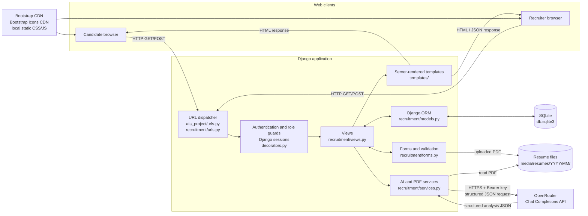
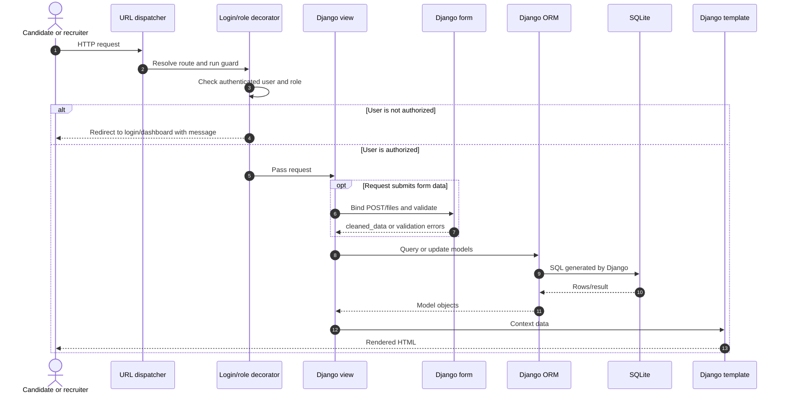
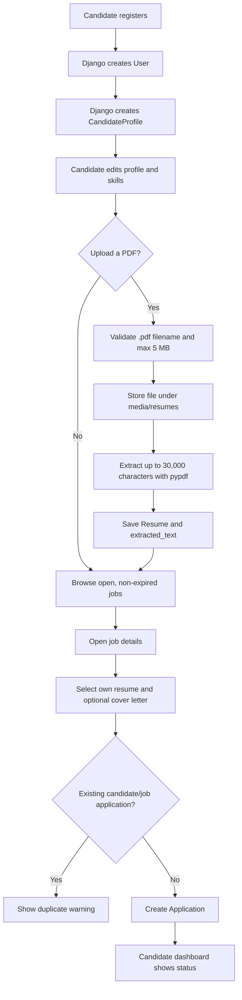
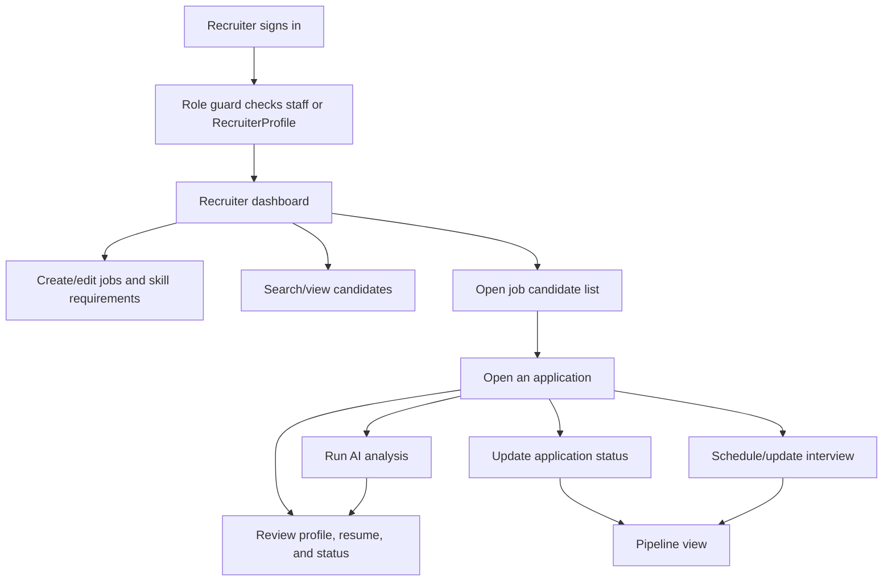
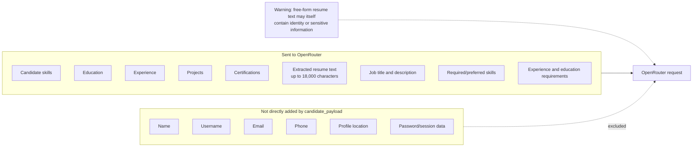
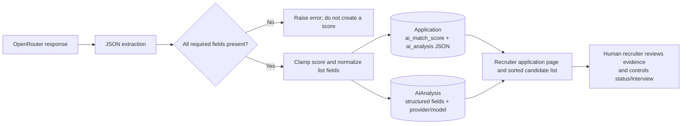
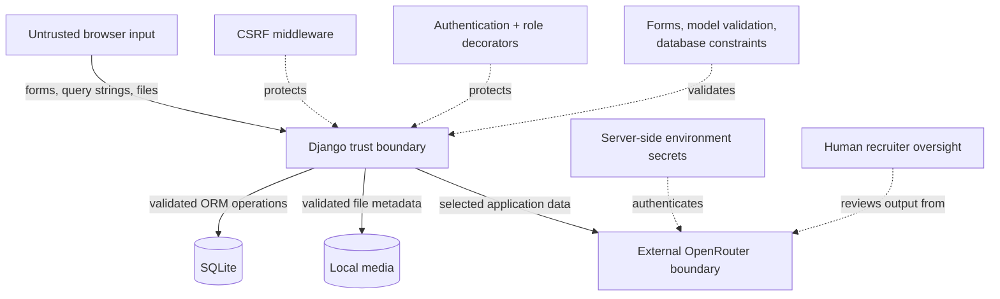

# Architecture and Data-Flow Diagrams

The project is a server-rendered Django application. The browser communicates with Django views; views use forms, services, and the Django ORM; SQLite stores application data; uploaded PDFs are stored under `media/`; and only the Django server communicates with OpenRouter.

## System architecture



## Django request flow



Public landing, job-list, and job-detail pages do not use a role guard. Candidate actions use `candidate_required`; recruiter actions use `recruiter_required`. Django's CSRF middleware protects normal POST forms, and important state-changing views such as delete, status update, and AI analysis require POST.

## Candidate application flow



The application form restricts the resume selector to resumes owned by the signed-in candidate. A database uniqueness constraint provides a second layer of duplicate prevention.

## Recruiter workflow



## OpenRouter AI analysis flow

```mermaid
sequenceDiagram
    autonumber
    actor Recruiter
    participant Browser
    participant View as analyze_application view
    participant Service as recruitment/services.py
    participant PDF as pypdf / resume file
    participant OpenRouter as OpenRouter API
    participant DB as SQLite via Django ORM

    Recruiter->>Browser: Click Run AI Analysis
    Browser->>View: POST /hr/applications/{id}/analyze/
    View->>View: Verify login, recruiter role, POST method
    View->>DB: Load Application and relations
    View->>Service: analyze_application_with_ai(application)

    alt API key is missing
        Service-->>View: Raise configuration error
        View-->>Browser: Error message or HTTP 502 JSON
    else API key is configured
        alt Resume extracted_text is empty
            Service->>PDF: Extract text from stored PDF
            PDF-->>Service: Plain text
            Service->>DB: Save extracted_text
        end

        Service->>Service: Build anonymized qualification payload
        Note over Service: Candidate skills, education, experience,<br/>projects, certifications, and resume text;<br/>job description and requirements.<br/>Direct identity/contact fields are omitted.

        Service->>OpenRouter: POST /api/v1/chat/completions<br/>Bearer key, model, JSON response format<br/>temperature 0.1, max_tokens 2000, timeout 90s
        OpenRouter-->>Service: choices[0].message.content
        Service->>Service: Remove optional code fence and parse JSON
        Service->>Service: Require 8 keys, normalize lists,<br/>clamp score to 0–100
        Service-->>View: Validated Python dictionary
        View->>DB: Update Application.ai_match_score<br/>and Application.ai_analysis
        View->>DB: update_or_create AIAnalysis<br/>with model metadata
        View-->>Browser: Success message or AJAX JSON score
    end
```

## AI payload boundary



The API key is loaded into Django settings from the server environment. It does not cross the browser boundary. The application's `HTTP-Referer` header is currently fixed to `http://localhost:8000`, and `X-Title` identifies this college project.

## Structured AI result



Required result keys are:

```text
match_score
matching_skills
missing_skills
relevant_experience
relevant_projects
strengths
concerns
explanation
```

## Data storage boundaries

| Data | Storage | Notes |
|---|---|---|
| Users and password hashes | SQLite/Django auth tables | Django stores password hashes, not plaintext passwords. |
| Profiles, jobs, applications, statuses, and interviews | SQLite | Accessed through Django ORM. |
| AI output | `Application` JSON/score and `AIAnalysis` | Stores the latest generated result. |
| Uploaded PDFs | Local `media/resumes/<year>/<month>/` | Served by Django only while `DEBUG=True` in the included URL configuration. |
| Extracted resume text | `Resume.extracted_text` in SQLite | Limited to 30,000 characters during extraction; up to 18,000 are placed in the AI payload. |
| API key | Server environment or local `.env` | `.env` is ignored by Git and the value is never intentionally rendered. |
| Static assets | Local `static/` plus CDN assets | Bootstrap and Bootstrap Icons are fetched by the browser from jsDelivr. |

## Trust boundaries and controls



### Current controls

- Django session authentication and password hashing
- Candidate and recruiter authorization decorators
- CSRF middleware
- POST-only decorators on sensitive actions
- Django form validation and ORM parameterization
- Database uniqueness for candidate/job applications
- API timeout and structured-output checks
- System prompt excluding protected traits from analysis
- Human-controlled status and interview workflow

### Important limitations

- SQLite, local media storage, and `runserver` are development choices.
- Password validators are disabled in current settings.
- File checks cover extension and size, not malware scanning or robust MIME/content validation.
- AI calls run synchronously inside the request.
- Resume text can contain personal information even though direct profile identity fields are omitted.
- Model responses may be inaccurate or biased and require human review.
- Provider errors are currently surfaced in the user-facing error text.

For setup, environment variables, testing, and production cautions, return to [README.md](README.md). For model relationships, see [DATABASE_DIAGRAM.md](DATABASE_DIAGRAM.md).
